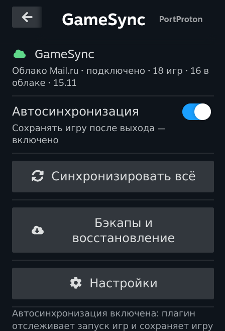
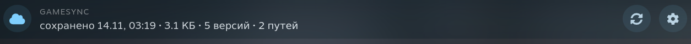
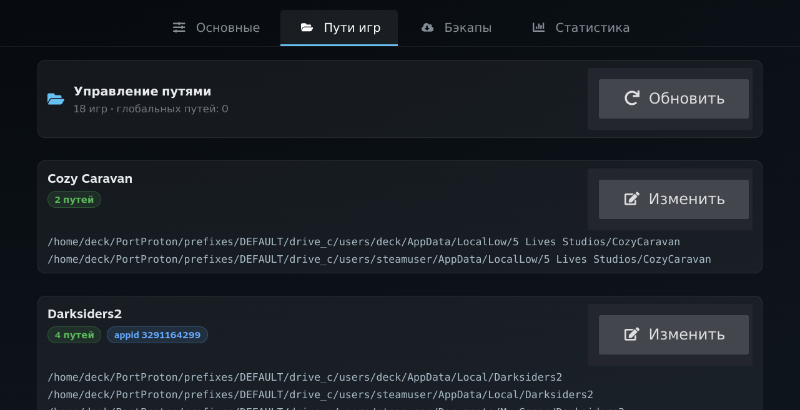

# 🎮 GameSync · PortProton Edition

**Сохранения non-Steam игр — в облаке. Без rclone, без ПК, без ручных путей.**

[](https://github.com/Differin3/GameSync-NonSteam/releases)
[](https://github.com/Differin3/GameSync-NonSteam/actions)
[](LICENSE)
[](https://github.com/SteamDeckHomebrew/decky-loader)
[](https://www.steamdeck.com/)

[](https://boosty.to/gamesync.nonsteam/single-payment/donation/842705/target?share=target_link)

> **Зеркало для России:** [GitFlic](https://gitflic.ru/project/d1fferin/gamesync-nonsteam) · **Скачать:** [последний релиз](https://github.com/Differin3/GameSync-NonSteam/releases/latest/download/gamesync-nonsteam.zip)

---

## ✨ Зачем это

PortProton запускает non-Steam игры, но их сохранения живут только на Deck.
GameSync делает из этого нормальную облачную синхронизацию:

- 🎯 **сам находит пути** сохранений — по App ID, Ludusavi, OpenCloudSaves,
  эмуляторам (CPY/CODEX/RUNE), `steam_emu.ini`, файлам рядом с `.exe` и обучению;
- ☁️ **хранит в вашем облаке** — WebDAV, S3, FTP/FTPS или SFTP;
- 🔁 **двусторонняя синхронизация** — загружает после выхода и подтягивает перед запуском;
- 🕘 **версии** — откат к любой из 3/5/10/20/50 сохранённых версий;
- 🛡 **безопасность** — страховочная копия, SHA256, карантин и авто-откат;
- 🎮 **всё на Deck** — QAM, строка на странице игры, статистика.

---

## 📸 Как это выглядит

| Быстрое меню (QAM) | Строка на странице игры |
|---|---|
|  |  |

| Пути сохранений | Бэкапы и восстановление |
|---|---|
|  |  |

| Основные настройки | Статистика |
|---|---|
|  |  |

> Ещё скриншоты: [QAM полностью](mockups/shots/real-08-qam-full.png) · [широкая строка игры](mockups/shots/real-07-game-row-wide.png)

---

## 🚀 Установка

1. Скачайте **[gamesync-nonsteam.zip](https://github.com/Differin3/GameSync-NonSteam/releases/latest/download/gamesync-nonsteam.zip)**.
2. Decky Loader → Developer → **Install from ZIP**.
3. Откройте плагин: при первом запуске он поставит Python-зависимости
   (`requests`, `boto3`, `paramiko`, `psutil`, `PyYAML`) — нужен интернет один раз.

Готово. Дальше — выберите хранилище и нажмите «Синхронизировать всё».

### Требования

- Steam Deck / SteamOS (или Linux с Decky Loader);
- PortProton;
- Decky Loader 2.x+;
- ~10 МБ на диске + место под временные архивы.

---

## ☁️ Хранилища

| Тип | Сервисы | Когда выбирать |
|---|---|---|
| **WebDAV** | Облако Mail.ru (бесплатно), Яндекс Диск, Nextcloud/ownCloud, Fastmail, свой сервер | Проще всего, если нет сервера |
| **S3** | Yandex Object Storage, VK Cloud, Cloud.ru, Backblaze B2, Wasabi, AWS S3, DigitalOcean Spaces | Уже есть бакет |
| **FTP/FTPS** | Свой NAS/сервер | Есть FTP |
| **SFTP** | Свой SSH-сервер/NAS | Нужен SSH |

> **Что выбрать?** Если не уверены — **Облако Mail.ru**: нужны почта и
> **пароль приложения** (не основной пароль). Яндекс Диск по WebDAV требует
> подписку Яндекс 360 — на бесплатном тарифе запись вернёт HTTP 402.

---

## ⚡ Быстрый старт

1. **Настройки → Тип хранилища** — выберите сервис, введите логин/пароль приложения.
2. **Сохранить и проверить** — плагин проверит доступ.
3. **Настройки → Синхронизация с облаком** — включите главный тумблер
   (двусторонняя: сохранять после выхода + загружать перед запуском).
4. **Синхронизировать всё** — первый бэкап всех найденных игр.
5. Запускайте игру как обычно. Вернувшись, увидите свежую версию в «Бэкапах».

---

## 🔁 Режимы синхронизации

| Режим | После выхода | Перед запуском | Для чего |
|---|---|---|---|
| **Двусторонняя** | ✅ загружает | ✅ скачивает | Обычный сценарий, несколько Deck |
| **Только выгрузка** | ✅ загружает | ❌ | Бэкап без изменения локальных сейвов |
| **Только загрузка** | ❌ | ✅ скачивает | Только забирать облако (прогресс не уходит в облако) |
| **Выключено** | ❌ | ❌ | Только ручные кнопки |

Главный тумблер включает обе стороны сразу; тонкая настройка — под ним.

> Pull срабатывает, только если облачный бэкап **новее** локальных сейвов.
> Перед перезаписью создаётся локальная страховка, в облако она не заливается.

---

## 🧠 Как это работает

### Поиск путей сохранений

Плагин не заставляет вручную прописывать пути. Он проверяет:

- точный Steam App ID (`steam_appid.txt`);
- базы **Ludusavi** и **OpenCloudSaves** (по ID и названию);
- папки эмуляторов: CPY, CODEX, RUNE, Public Documents;
- `steam_emu.ini` и `ALI213.ini`;
- файлы рядом с `.exe` и в `userdata`;
- эвристики и **обучение по сессии** — запоминает найденные папки.

Если что-то не нашлось — во вкладке «Пути игр» можно добавить вручную,
проверить содержимое и исключить лишнее.

### Версии и восстановление

- Каждая синхронизация — отдельная версия в облаке.
- Хранится 3/5/10/20/50 версий (настраивается), старые удаляются автоматически.
- Восстановить можно **любую** версию, не только последнюю.
- Перед восстановлением создаётся страховочная копия.
- Файлы, которых нет в выбранной версии, **не удаляются**, а уходят в карантин
  (`~/.config/gamesync/quarantined`).
- Архивы и файлы проверяются по **SHA256**; при несовпадении — **авто-откат**
  из страховочной копии.

### Защита от гонок

- Ручной restore **блокируется**, если игра запущена (проверяется игровой exe,
  а не просто открытый GUI PortProton).
- Pull не начинается, если игра уже работает; отменяется по дедлайну.
- Два restore одновременно не выполняются.
- Синхронизация ждёт завершения записи, чтобы не залить недописанные файлы.
- Повторный pull в течение 10 минут не выполняется (защита прогресса).
- Служебные файлы (логи, кэш) не влияют на сравнение «локальные новее».
- Перед архивацией проверяется свободное место.

---

## 🔐 Приватность

- Настройки, пароли и история — **только на устройстве** (`~/.config/gamesync/`).
- Пароли уходят **только** в выбранное вами хранилище.
- Нет телеметрии и аналитики.
- Сеть: Ludusavi-манифест (GitHub), PyPI (зависимости при первом запуске)
  и ваше хранилище.

---

## 🛠 Разработка

```bash
npm install          # зависимости фронтенда
npm run build        # собрать dist/
build.bat            # собрать gamesync-nonsteam.zip (Windows)

python -m unittest discover -s tests -v   # 106 тестов
python -m pyflakes backend main.py        # backend-линт
npm run lint                              # frontend-линт
```

Структура: `backend/` — Python-бэкенд Decky, `src/` — React/TS UI,
`tests/` — юнит-тесты, `docs/` — документация и store-тексты.

---

## ❤️ Поддержать проект

GameSync бесплатный и без рекламы. Если он экономит вам нервы и время —
можно угостить автора кофе:

[](https://boosty.to/gamesync.nonsteam/single-payment/donation/842705/target?share=target_link)

**Boosty:** https://boosty.to/gamesync.nonsteam/single-payment/donation/842705/target?share=target_link

Спасибо каждому, кто пользуется, пишет баг-репорты и поддерживает проект. 💙

---

## 🔗 Ссылки

- [GitHub](https://github.com/Differin3/GameSync-NonSteam) · [GitFlic](https://gitflic.ru/project/d1fferin/gamesync-nonsteam)
- [Релизы](https://github.com/Differin3/GameSync-NonSteam/releases) · [Issues](https://github.com/Differin3/GameSync-NonSteam/issues)
- [CHANGELOG](CHANGELOG.md) · [API](docs/API.md) · [Лицензия MIT](LICENSE)

---

## 🇬🇧 English (short)

**GameSync PortProton** backs up and syncs save files of non-Steam games
launched via PortProton — WebDAV, S3, FTP/FTPS or SFTP; automatic save-path
detection, versioned backups, restore any version, pull-before-launch,
auto-sync after exit, SHA256 verification, quarantine and automatic rollback.

Install: [latest release zip](https://github.com/Differin3/GameSync-NonSteam/releases/latest/download/gamesync-nonsteam.zip)
→ Decky Loader → Developer → Install from ZIP.

**Support the project:** [Boosty](https://boosty.to/gamesync.nonsteam/single-payment/donation/842705/target?share=target_link)
