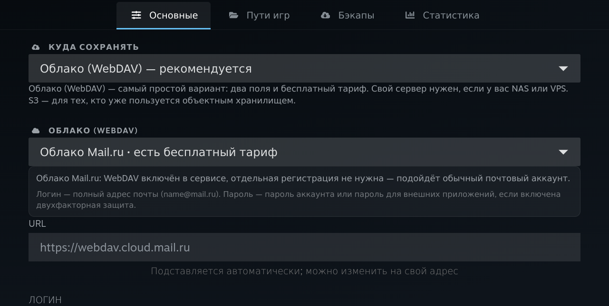
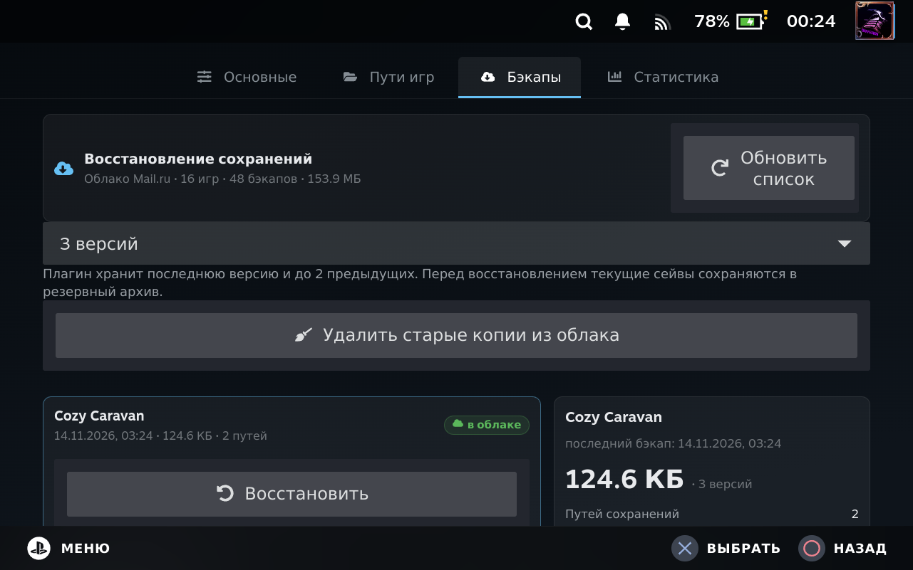
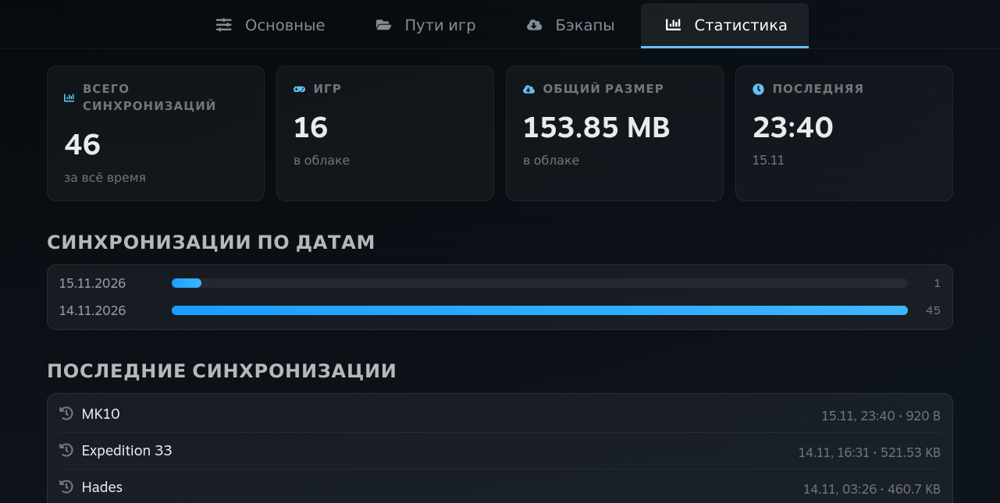

# GameSync (PortProton Edition)

[](https://github.com/Differin3/GameSync-NonSteam/releases)
[](LICENSE)

Зеркало (Россия): [GitFlic](https://gitflic.ru/project/d1fferin/gamesync-nonsteam)

## Скриншоты / Screenshots

| QAM | Строка на странице игры / Game page row | Пути игр / Save paths |
|---|---|---|
|  |  |  |

| Основные / General | Бэкапы / Backups | Статистика / Statistics |
|---|---|---|
|  |  |  |

---

## 🇷🇺 Русский

Плагин для Decky Loader, синхронизирующий сохранения игр PortProton с облачным хранилищем:

- через **WebDAV** (Облако Mail.ru — бесплатный тариф, Яндекс Диск, Nextcloud/ownCloud, Fastmail и любой свой WebDAV-сервер)
- через **S3‑совместимые object storage** (Yandex Object Storage, VK Cloud, Cloud.ru, Backblaze B2, Wasabi, AWS S3, DigitalOcean Spaces и др.)
- через **FTP/FTPS** или **SFTP** (собственный сервер/NAS)

> **Что выбрать?** Если не уверены — «Облако (WebDAV) → Облако Mail.ru»: нужны почта
> и **пароль приложения**. Яндекс Диск по WebDAV требует подписку Яндекс 360
> (на бесплатном тарифе запись отвечает HTTP 402). S3, FTP и SFTP — для тех,
> у кого уже есть сервер или бакет.

### Установка

#### Сборка на Windows

1. Node.js 20+ и зависимости:
```bash
npm install
npm run build
```
2. Соберите архив (`build.bat`) — получится `gamesync-nonsteam.zip`.

### Установка на Steam Deck

Готовый архив (последняя версия):
**https://github.com/Differin3/GameSync-NonSteam/releases/latest/download/gamesync-nonsteam.zip**

Все версии: [Releases](https://github.com/Differin3/GameSync-NonSteam/releases).

1. Скачайте `gamesync-nonsteam.zip` и скопируйте на Deck.
2. Decky Loader → Developer → **Install from ZIP**.
3. Плагин сам поставит Python-зависимости (requests, boto3, paramiko, psutil, PyYAML)
   при первом запуске — нужен интернет один раз.

### Настройка хранилища

1. Настройки плагина → «Тип хранилища».
2. **WebDAV**: выберите сервис (URL подставится), введите логин и **пароль приложения**.
   - Mail.ru: логин — полный адрес `name@mail.ru`; пароль приложения создаётся
     в Настройках → Безопасность → Пароли для внешних приложений.
   - Яндекс: логин — полный адрес `name@yandex.ru`; WebDAV пишет только с подпиской 360.
   - OAuth-токен нужен только Яндексу; для остальных он не используется.
3. **S3 / FTP / SFTP** — укажите параметры сервера и нажмите «Проверить и сохранить».
4. Кнопка проверяет не только чтение, но и **создание папки**: «успех» без права
   записи больше не показывается.

### Быстрое меню (QAM)

- Статус: `Облако Mail.ru · подключено · N игр · M в облаке` (иконка зелёная/красная).
- Тумблер **«Автосинхронизация»** — сохранять игру после выхода.
- **«Синхронизировать всё»** — прогресс-бар с этапами: сканирование → архивация →
  загрузка → история версий, текущая игра и счётчик `N/M`, успешные/ошибочные.
- **«Бэкапы и восстановление»** и **«Настройки»** — переход на полную страницу.

### Страница игры в библиотеке

- Строка GameSync под кнопкой «Играть»: дата последней синхронизации, размер,
  число версий и путей.
- Клик по облачку (или A на геймпаде) — синхронизировать игру; во время работы спиннер.
- Зелёная точка — бэкап моложе 24 часов; статус обновляется раз в минуту.

### Вкладки настроек

- **Основные** — хранилище, автосинхронизация, глобальные пути, опасная зона.
- **Пути игр** — карточка на игру, пути, кандидаты, добавление/исключение,
  кнопка **«Проверить содержимое»**: показывает файлы, размеры, даты и сколько
  из них похоже на сейвы (если только логи — предупреждение).
- **Бэкапы** — список игр, боковая карточка версий, восстановление,
  **«Скачать .tar.gz»** (в `/home/deck/Downloads`), выбор **«Хранить версий на игру»**
  (3/5/10/20/50) и **«Удалить старые копии из облака»** (чистка «сирот»).
- **Статистика** — синхронизации, игры в облаке, занятое место, последняя
  синхронизация, график по датам и последние записи.

Все вкладки управляются геймпадом: вкладки и контент — `Focusable`, активная
вкладка получает фокус; подвал Steam не перекрывает контент (запас 48 px).

### Как плагин находит пути сохранений

Источники отсортированы по надёжности:

1. **Точный Steam App ID**: `steam_appid.txt` / `steam_settings/steam_appid.txt`
   рядом с игрой → поиск в Ludusavi и OpenCloudSaves **по ID**, а не по названию.
2. **Эмуляторы**:
   - `Documents/CPY_SAVES/CPY/<appid>` и `SKIDROW/...`;
   - `AppData/Roaming/<HOODLUM|CODEX|RUNE|…>/<appid>/remote`;
   - `users/Public/Documents/Steam/<EMU>/<appid>`;
   - путь из `steam_emu.ini` (`Game data is stored at %SystemDrive%\…`).
3. **Steam userdata** по реальному App ID: `userdata/<uid>/<appid>/remote`.
4. **Папка игры**: `save/saves/profile/Data` рядом с exe, файлы `*save*`, `*.sav`.
5. **Известные пути** Ludusavi/OpenCloudSaves по названию (с нормализацией:
   годы и слова-изданий отбрасываются).
6. **Эвристика** по `drive_c` (Documents, Saved Games, AppData, LocalLow).
7. **Обучение**: после выхода из игры ищутся файлы, изменённые за сессию, —
   это самый точный сигнал; пути запоминаются.
8. **Ручные пути** пользователя.

Защита от мусора:

- логи, `.txt`, `.dll`, `.exe`, картинки, кэш и системные папки не считаются сейвами;
- папка только из служебных файлов отбрасывается;
- перед архивацией проверяется число «осмысленных» файлов: если 0 — синхронизация
  возвращает ошибку, а не создаёт пустой архив на 3 КБ.

### Синхронизация и автосинхронизация

- Каждая синхронизация: `GameSync/<Игра>/backup-<дата>.tar.gz` (версия) +
  `GameSync/<Игра>.tar.gz` (стабильная копия, перезаписывается).
- Лимит версий настраивается (3/5/10/20/50); при превышении старые записи
  удаляются из истории **и из облака**.
- Автосинхронизация ловит игры в общем префиксе `DEFAULT` (по каталогу exe)
  и игры с собственным префиксом; синхронизация запускается после выхода,
  когда завершился последний Wine-процесс.
- После автосинхронизации показывается тост «Сохранено: игра · размер».
- **Режимы синхронизации**: главный тумблер включает обе стороны; в настройках
  можно оставить только выгрузку или только загрузку (с предупреждением).
- **Загрузка перед запуском** (опция): при старте игры плагин скачивает
  облачный бэкап, если он новее локальных сейвов, и показывает тост
  «Сохранения загружены». Перед перезаписью создаётся страховочная копия.

### Восстановление

1. «Бэкапы» → выберите игру → в правой панели отметьте нужную версию →
   «Восстановить выбранную версию». Можно выбрать любую из списка, включая
   `prerestore`. Там же — «Удалить выбранную версию» (из облака и истории).
2. Перед записью текущие сейвы уходят в облако как `prerestore-<дата>.tar.gz` —
   откатиться можно из этого же списка. Новые файлы сохранений не удаляются,
   а **перемещаются в локальный карантин** `~/.config/gamesync/quarantined/`. 
3. Если в архиве нет настоящих файлов (восстановлено 0), интерфейс предупредит:
   вероятно, бэкап собран по неверному пути.

Ограничения:

- восстановление работает для архивов 0.3.0+ (с манифестом);
- старые архивы нужно пересоздать синхронизацией;
- файлы возвращаются по путям из манифеста (при переименовании префикса путь
  останется прежним).

### Чистка облака

Кнопка «Удалить старые копии из облака» сравнивает файлы в `GameSync/<Игра>/`
с историей и удаляет только `backup-*.tar.gz` / `prerestore-*.tar.gz`,
на которые нет ссылок. Текущие версии и посторонние файлы не трогаются.
Листинг работает для WebDAV, S3, FTP и SFTP.

### Структура проекта

- `backend/` — Python-бэкенд (сканирование путей, синхронизация, провайдеры,
  восстановление, статистика, уборка)
- `src/` — React-фронтенд
- `tests/` — unit-тесты (`python -m unittest discover -s tests`)
- `docs/` — архитектура, API, решение проблем
- `mockups/` — HTML-макеты и скриншоты
- `plugin.json`, `requirements.txt`

Документация: [CHANGELOG.md](CHANGELOG.md) · [docs/ARCHITECTURE.md](docs/ARCHITECTURE.md) · [docs/API.md](docs/API.md) · [docs/TROUBLESHOOTING.md](docs/TROUBLESHOOTING.md) · [docs/PUBLISHING.md](docs/PUBLISHING.md) · [docs/STORE.md](docs/STORE.md)

---

## 🇬🇧 English

Decky Loader plugin that syncs PortProton game saves to cloud storage:

- **WebDAV** (Mail.ru Cloud — free tier, Yandex Disk, Nextcloud/ownCloud, Fastmail, custom)
- **S3-compatible object storage**
- **FTP/FTPS** or **SFTP**

> **Not sure what to pick?** Use “Cloud (WebDAV) → Mail.ru Cloud”: an app password is
> enough. Yandex Disk WebDAV requires Yandex 360 (free tier returns HTTP 402 on writes).

### Installation

Latest release archive:
**https://github.com/Differin3/GameSync-NonSteam/releases/latest/download/gamesync-nonsteam.zip**

All versions: [Releases](https://github.com/Differin3/GameSync-NonSteam/releases).

Build from source:

```bash
npm install
npm run build
```

Build `gamesync-nonsteam.zip` (`build.bat`), then Decky Loader → Developer →
**Install from ZIP**. Python dependencies are installed automatically on first launch.

### Storage setup

1. Pick a storage type and a service preset.
2. WebDAV: full login (e.g. `name@mail.ru`) and an **app password**.
   Yandex requires a full `name@yandex.ru` login and a Yandex 360 subscription.
3. The test button checks **write access** (creates the folder), so a read-only
   cloud no longer reports a false success.

### Quick access menu

- Status line with provider and connection state (green/red).
- **Auto-sync** toggle (sync the game after it exits).
- **Sync all** with a progress bar and stages (scan → archive → upload → history),
  current game, `N/M` counter, success/error counts.
- Buttons to open Backups and Settings.

### Game page row

Under the Play button: last sync date, size, versions and path count. Click the
cloud icon (or press A on a gamepad) to sync; green dot means a backup younger
than 24 hours; the row refreshes every minute.

### Settings tabs

- **General** — storage, auto-sync, global paths, danger zone.
- **Game paths** — per-game cards, candidates, add/exclude, and **“Check contents”**
  (files, sizes, dates, how many look like saves; warns if only logs are found).
- **Backups** — games list, versions sidebar, restore, **download .tar.gz**
  to `/home/deck/Downloads`, **versions to keep** (3/5/10/20/50) and
  **“Delete old copies from cloud”** (orphan cleanup).
- **Statistics** — syncs, games in cloud, used space, last sync, per-date chart.

All tabs are gamepad-navigable (`Focusable`, active tab auto-focused), and the
Steam footer does not cover the content.

### How save paths are found

1. **Exact Steam App ID** from `steam_appid.txt` / `steam_settings` → Ludusavi and
   OpenCloudSaves lookups by ID.
2. **Emulators**: `Documents/CPY_SAVES/CPY/<appid>`, `SKIDROW/...`,
   `AppData/Roaming/<HOODLUM|CODEX|RUNE>/<appid>/remote`,
   `users/Public/Documents/Steam/<EMU>/<appid>`, and the path from `steam_emu.ini`.
3. **Steam userdata** by real App ID (`userdata/<uid>/<appid>/remote`).
4. **Game folder**: `save/saves/profile/Data` next to the exe and `*save*` files.
5. **Known paths** from Ludusavi/OpenCloudSaves by normalized name.
6. **Heuristics** across `drive_c` (Documents, Saved Games, AppData, LocalLow).
7. **Session learning**: files modified while the game ran become learned paths.
8. **Manual paths** entered by the user.

Junk protection: logs/txt/dll/exe/images/cache are ignored; folders with only
service files are dropped; before archiving the plugin counts meaningful files
and refuses to create an empty backup.

### Sync & auto-sync

- Every sync creates `GameSync/<Game>/backup-<date>.tar.gz` plus a stable
  `GameSync/<Game>.tar.gz` (overwritten).
- Retention is configurable (3/5/10/20/50); older versions are removed from the
  history **and from the cloud**.
- Auto-sync detects games in the shared `DEFAULT` prefix (by executable folder)
  and named prefixes, and fires after the last Wine process exits.
- A toast reports “Saved: game · size” after auto-sync.

### Restore

Pick a game and version, confirm — current saves are uploaded as
`prerestore-<date>.tar.gz` first. If an archive contains no real files, the UI
warns instead of silently reporting success.

### Cloud cleanup

“Delete old copies from cloud” compares files in `GameSync/<Game>/` with the
history and deletes only unreferenced `backup-*.tar.gz` / `prerestore-*.tar.gz`.
Works for WebDAV, S3, FTP and SFTP.

### Project structure

`backend/` (scanning, sync, providers, restore, stats, cleanup), `src/` (React),
`tests/`, `docs/`, `mockups/`, `plugin.json`, `requirements.txt`.

Documentation: [CHANGELOG.md](CHANGELOG.md) · [docs/ARCHITECTURE.md](docs/ARCHITECTURE.md) · [docs/API.md](docs/API.md) · [docs/TROUBLESHOOTING.md](docs/TROUBLESHOOTING.md) · [docs/PUBLISHING.md](docs/PUBLISHING.md) · [docs/STORE.md](docs/STORE.md)
